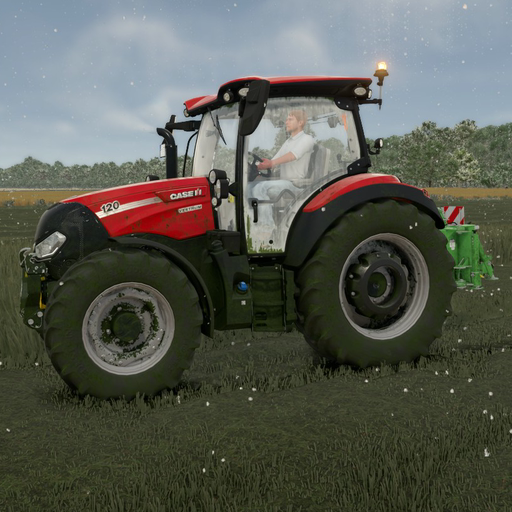

# Grounded Tractors (FS25)

Farming Simulator 25 tractors bounce over ditches like they are on springs. This mod makes them feel heavy:

| Situation | Stock | Grounded Tractors |
|---|---|---|
| Crawling out of a ditch at 5–10 km/h | nose hangs in the air | all four wheels stay down |
| Crossing a ditch at 40 km/h | whole tractor launches, >0.5 s airborne | front lifts a little and lands, no spin |

## What it changes

Only motorized vehicles; implements and trailers are untouched.

- **Centre of mass** 0.3 m lower and 0.5 m forward on the chassis.
- **Suspension travel x0.4.** Counter-intuitively, *longer* travel made it worse: the suspension stores the ditch and gives it back as a jump (see [docs/acceptance.md](docs/acceptance.md)).
- **Angular damping only while airborne.** Constant damping was tried and rejected: it holds the pitch after a ramp and the tractor "takes off like a plane".

## Install

Download `FS25_GroundedTractors.zip` from Releases into `Documents/My Games/FarmingSimulator2025/mods` and enable it in the savegame. Multiplayer is declared (ModHub requires it) but only tested in singleplayer.

## Tuning from the console

Enable `<development><controls>true</controls>` in `game.xml`, then in the `~` console:

| Command | Default | Does |
|---|---|---|
| `gtOff` | | everything back to stock until the next restart |
| `gtTravel <k>` | 0.4 | suspension travel multiplier |
| `gtAir <v>` | 2 | angular damping while all wheels are off the ground |
| `gtCom <m>` / `gtComZ <m>` | 0.3 / 0.5 | centre of mass lower / forward |
| `gtInfo` | | prints mass, centre of mass and wheel values of the vehicle you are in |
| `gtUpright` | | stands tipped-over loose implements within 8 m back up |
| `gtHud` | | hides / shows the HUD for screenshots |

## Development

- `bash check.sh`: syntax check every `.lua` with LuaJIT (Docker).
- `bash build.sh`: writes `dist/FS25_GroundedTractors.zip`.
- Icon: in-game screenshot (HUD hidden with `gtHud`), `docs/icon.png`.

License: MIT. ModHub checklist: [docs/modhub.md](docs/modhub.md).

Pull requests with videos of other tractors very welcome.

## Releasing

1. Bump `<version>` in `FS25_GroundedTractors/modDesc.xml` and add a `## <version>` section to CHANGELOG.md.
2. `git tag v<version> && git push --tags`. The release workflow refuses a tag that does not match the modDesc version, builds the zip and publishes the release with the CHANGELOG section as notes.
3. Upload the same zip to ModHub (updates as `FS25_GroundedTractors_update.zip`, see docs/modhub.md).
